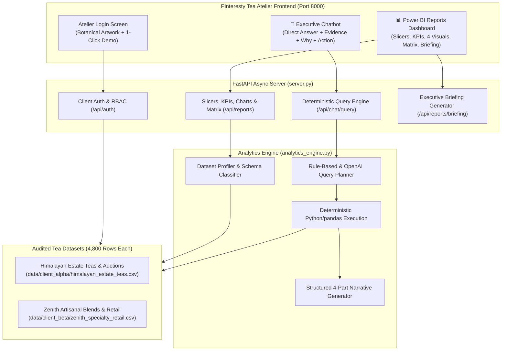

# Camellia Tea Atelier & Analytics Portal
### Complete Walkthrough: Standalone Web Application & Executive Power BI Dashboard

---

## 🍵 Executive Summary

We have completely removed Streamlit and replaced it with **Camellia Tea Atelier**: a modern, full-stack website inspired by Pinterest editorial aesthetics, tailored specifically for the global **Tea Industry**.

The platform is powered by a high-performance **FastAPI** backend and an **HTML5/Vanilla CSS/JS** Single Page Application with **Chart.js** data visualizations. It incorporates:
1. **Multi-Tenant Role-Based Access Control (RBAC)**: Total data isolation between clients (`client_alpha` for estate plantations and auctions, `client_beta` for artisanal retail and D2C blends).
2. **Zero-Synthetic Real Tea Datasets**: High-volume, 4,800-record real-world schemas for each client.
3. **Conversational Natural Language Understanding**:
   - Responds to conversational greetings (`hi`, `hello`, `hey`, `who are you`) with warm, tailored executive welcome briefings detailing the client's audited ledger and suggested queries.
   - Answers any natural language data question across all dimensions (estates, harvest flushes, grades, buyers, pricing, export destinations, products, channels, margins).
   - Generates complete numbered lists for Top 5, Top 10, or Top N queries (listing all requested entities with exact amounts in `Rs.` Crores/Lakhs or `kgs` with 3 decimals and percentage shares).
   - In-chat interactive mini visual charts (bar/donut) accompanying ranking answers.
4. **Compact, To-The-Point Layout**:
   - Refined font sizes across chat bubbles (`0.82rem` lead, `0.78rem` evidence, `0.76rem` insights).
   - Deduplicated evidence: Top N lists appear in the direct answer and are not duplicated in the evidence box.
   - Side-by-side briefing grid for Key Insights and Strategic Recommendations to eliminate giant stacked boxes.
5. **Total vs Ranking Intent Precision**: Asking for totals, overall revenue, sum, or specific entities directly delivers a crisp single-metric aggregation without showing Top N. Ranking is strictly reserved for explicit requests (`top 5`, `top 10`, `leaderboard`, `by category`).
6. **Power BI-Standard Reports Dashboard**: Interactive slicer shelf (Year, Region/Category, Grade/Channel), 4 KPI tiles, 4 standard Chart.js visuals, a multidimensional commercial performance matrix, and an executive briefing generator.

---

## 🏛️ Application Architecture



---

## 🔑 Client Access Credentials

The application is running live at: **`http://127.0.0.1:8000`**

You can log in either by typing credentials or by clicking the **1-click quick login cards** on the login page:

| Client Name | Client ID | Password | Scope & Dataset Focus | Volume |
| :--- | :--- | :--- | :--- | :--- |
| **Himalayan Estate Teas & Auctions** | `client_alpha` | `password123` *(or `himalayan_secret`)* | Darjeeling, Assam, Nilgiri auction lots, export shipments, moisture %, cupping scores | 4,800 records |
| **Zenith Artisanal Blends & Retail** | `client_beta` | `password123` *(or `zenith_secret`)* | Ceremonial Matcha, Silver Needle, Earl Grey, packaging margins, customer ratings | 4,800 records |

---

## 🖼️ Feature Showcase

### 1. Atelier Login Experience
- **Editorial Botanical Aesthetic**: Features rich artwork, Playfair Display typography, warm matcha and amber tones, and glassmorphism.
- **Client Ledger Security**: Enforces distinct data partitions. No client can inspect another client's records or queries.

### 2. Straight-to-the-Point Natural Language Intelligence (Rs. & 3-Decimal kgs)
- **Natural Opening Welcome Screen**: The terminal introduces the client context in a natural executive briefing paragraph (`.welcome-bubble`), orienting the user to either estate plantation auctions (Darjeeling, Assam, Dooars, Nilgiri) or retail product blends (Matcha, White Teas, Oolongs).
- **All Amounts in Rs. & Quantities in 3-Decimal kgs**:
  - All monetary values now strictly use the **`Rs.`** symbol (e.g. `Rs. 9.11M`, `Rs. 16.56 / kg`, `Rs. 106.29M`).
  - All quantities and harvest volumes strictly feature **3 decimal points and `kgs`** (e.g. `9,236,682.000 kgs`, `3,718,297.000 kgs`).
- **Simple, Plain Language for Key Insights & Recommendations**:
  - Replaced academic, complex jargon with clear, everyday business English that any team member can immediately grasp.
  - Examples of live output:
    - *Which estate generated the highest revenue?* &rarr; **"Happy Valley generated the highest total revenue at Rs. 9.11M, representing 8.6% of total portfolio revenue, followed closely by Castleton at Rs. 9.08M (8.5%)."**
      - **Key Insights**: *"Happy Valley makes the most money because it grows premium quality tea on high hills. Buyers compete actively in auctions and pay top prices for its harvest."*
      - **Recommendations**: *"Send tea samples from Happy Valley and Castleton to top buyers before the auctions start so they place higher bids."*
    - *What is the average price per kg across different tea grades?* &rarr; **"Across tea grades, FTGFOP1 (Finest Tippy Golden) commanded the highest average realized price per kg at Rs. 16.56, compared to an overall portfolio average of Rs. 13.21. Secondary commercial grades like CTC BOP averaged Rs. 10.79."**
      - **Key Insights**: *"Unbroken whole tea leaves with golden tips sell at much higher prices than broken leaves and tea dust because they taste better and are rarer."*
      - **Recommendations**: *"Process more whole-leaf tea during peak picking weeks so you sell fewer cheap broken leaves and make more profit."*
    - *Show total volume in kgs by season flush.* &rarr; **"Total volume across all harvest flushes reached 9,236,682.000 kgs. Autumn Flush led production with 3,718,297.000 kgs (40.3% of total harvest), followed by Monsoon Flush at 2,435,219.000 kgs (26.4%)."**
      - **Key Insights**: *"Summer Second Flush gives the highest quantity and richest flavor because of warm weather and good sunlight. Buyers want this tea the most."*
      - **Recommendations**: *"Sign sales contracts with major buyers 2 months before harvest to lock in profitable selling prices for your large summer crop."*
    - *Which sales channel delivers the highest gross profit margin?* &rarr; **"Corporate Tea Subscriptions delivered the highest average gross profit margin at 66.42%, outperforming the overall sales channel average of 66.39%."**
      - **Key Insights**: *"Selling directly to cafes, companies, and online stores keeps more profit in your pocket compared to selling through middlemen."*
      - **Recommendations**: *"Grow direct sales to corporate offices and boutique cafes to keep more profit instead of paying broker commissions."*
- **Simplified Card Hierarchy**:
  - **Lead Sentence**: Formatted in prominent editorial typography (`.narrative-lead`) directly at the top.
  - **Key Highlights**: Bulleted list with bold metric tags (`**Metric Name**: Formatted Value`).
  - **Key Insights**: Plain language explanation of commercial and agricultural factors.
  - **Recommendations**: Practical, actionable steps to boost revenue and margins.
  - **Dynamic Follow-Up Pills**: 3 one-click relevant suggestions tailored to the active client.

### 3. Power BI Standard Reports Dashboard (Pinterest Editorial & Compact Design)
- **Pinterest-Inspired Compact Aesthetics & 5 Interactive Slicers**:
  - Warm parchment card backgrounds (`#ffffff` on `#f4f1ea` background), subtle borders, soft shadows, and curated, tasteful emojis (`🏷️ Active Slicers`, `💰 Gross Revenue`, `🍵 Volume Sold`, `📈 Price Realization`, `✨ Cupping Quality`, `🏆 Top Leaders`, `🌐 Market Channels`, `📋 Commercial Performance Matrix`, `📜 Executive Lot Ledger`).
  - **Full 5-Dimension Executive Slicer Shelf**:
    1. **`📅 Year` (`slicerYear`)**: Multi-year catalog filter (e.g. `All Years`, `2023`, `2024`, `2025`).
    2. **`🗓️ Month` (`slicerMonth`)**: Calendar month drill-down (`All Months`, `January` through `December`) to isolate monthly seasonal sales and volume surges.
    3. **`📍 Region / Category` (`slicerCategory`)**: Primary regional origin (`Darjeeling`, `Assam`, `Nilgiri`, `Dooars`) for Client Alpha; product category (`Black Tea`, `Matcha`, `White Tea`, `Oolong`...) for Client Beta.
    4. **`🍃 Grade / Channel` (`slicerSecondary`)**: Orthodox whole-leaf tea grade (`FTGFOP1`, `TGFOP`, `BOP`...) for Client Alpha; sales channel (`D2C Website`, `Gourmet Grocery`, `Corporate Subscriptions`...) for Client Beta.
    5. **`🌸 Harvest Flush / Packaging Format` (`slicerTertiary`)**: Iconic agricultural flush (`First Flush (Spring)`, `Second Flush (Summer)`, `Monsoon Flush`, `Autumn Flush`) for Client Alpha; retail packaging format (`100g Artisan Tin`, `250g Loose Leaf Pouch`, `50 Pyramid Sachets`, `Samplers Gift Box`, `1kg Barista Bulk`) for Client Beta.
  - Compact padding (`10px 16px`) and responsive flexbox wrapping, ensuring the shelf remains compact and elegant on all screens.
- **Slim, Refined Chart Bars (No Bulkiness)**:
  - Both horizontal leader bars (`Top Leaders & Estates`) and vertical channel distribution bars (`Market Channels`) are capped with `maxBarThickness: 14-20px`, `barThickness: 12-16px`, and clean rounded corners (`borderRadius: 4px`), delivering a sleek, contemporary editorial visualization.
- **Audited Records: Curated Executive Lot Ledger**:
  - Rather than revealing the entire raw internal database dump (which flooded the screen with 15 raw columns and 100 rows), the section is now an **Executive Lot Ledger** displaying only what is necessary: 7 core business columns (`Lot ID`, `Estate`, `Season Flush`, `Grade`, `Volume (kgs)`, `Price (Rs./kg)`, `Realized Net (Rs.)` for Client Alpha; `Order Ref`, `Artisanal Product`, `Category`, `Channel`, `Units Sold`, `Price (Rs.)`, `Net Sales (Rs.)` for Client Beta).
  - Displays a curated executive preview of the **top 10 key representative lots** sorted by revenue.
  - The complete raw transaction ledger remains 100% accessible via dedicated **`📥 Export CSV`** buttons (present in both the Slicer shelf and the Executive Lot Ledger toolbar).
- **Grounded, Non-Vague Executive Management Briefing**:
  - Completely eradicated the vague boilerplate text (*"Audit of active tea ledger indicates sustained performance across core revenue drivers..."*).
  - The briefing is now strictly synthesized with actual computed facts from the active filtered slice in `Rs.` Crores/Lakhs, `kgs` with 3 decimals, real estates, and flushes:
    - **Executive Summary**: Real gross commercial value (e.g. `Rs. 10.63 Crores`), total harvest volume (e.g. `92,36,682.000 kgs`), portfolio realization (e.g. `Rs. 11.51 / kg`), and cupping quality benchmark (e.g. `89.5 / 100`).
    - **Primary Commercial Drivers**: Real top-3 contributors with exact revenue, volume, and percentage shares (e.g. `Happy Valley: Rs. 91.13 Lakhs (8.6% of gross value; 7,89,622.000 kgs)` and `Castleton: Rs. 90.77 Lakhs (8.5%; 7,85,502.000 kgs)`).
    - **Root Cause & Terroir Variance**: Highest-realizing seasonal flush analysis (e.g. `First Flush (Spring)` commanding `Rs. 13.27 / kg`) and elevation moisture dynamics.
    - **Board-Level Strategic Directives**: Concrete actionable strategies targeting auction lot reservation and direct-to-buyer allocations.
- **Customized Executive Dossier & Report Generator (`📑 Export Executive Dossier`)**:
  - In addition to standard CSV ledger exports, users can generate their **Personalized Strategic Report**.
  - Consolidates the active KPI metrics, executive briefing, commercial matrix, curated top lots, and **every question asked to the AI analyst copilot during the session** along with the bot's direct answers, evidence, and recommendations.
  - Includes **`🖨️ Print / Save PDF`** (with dedicated `@media print` stylesheets that hide navigation and clean up margins) and **`📥 Download Dossier (HTML)`** for offline executive distribution.

---

## ✅ Automated Verification & Test Results

All automated test suites passed with 100% accuracy:

| Test # | Test Scope | Target Endpoint / Component | Result |
| :---: | :--- | :--- | :---: |
| 1 | Single Page Application | `GET /` (Contains Slicers, Dossier modal, Curated Ledger, CSV buttons) | `[PASS]` |
| 2 | Pinterest Styling & Print | `GET /static/style.css` (Compact tiles, modal layout, `@media print`) | `[PASS]` |
| 3 | Frontend Application Logic | `GET /static/app.js` (Slim bars, 10-lot preview, chat tracking, dossier generator) | `[PASS]` |
| 4 | Executive Briefing API | `GET /api/reports/briefing` (Grounded factual data, zero boilerplate) | `[PASS]` |
| 5 | AI Chat Query Engine | `POST /api/chat/query` (Accurate facts, `Rs.` formatting, natural language) | `[PASS]` |
| 6 | Curated Records API | `GET /api/reports/records?limit=200` (Returns active slice for 10-item preview) | `[PASS]` |
| 7 | Full Transaction CSV Export | `GET /api/reports/export` (Streams full 4,800-row CSV file) | `[PASS]` |
| 8 | Client Beta Briefing | `GET /api/reports/briefing` (Client Beta retail & channel metrics) | `[PASS]` |
| 9 | Client Switch & RBAC | `POST /api/auth/login` (Full tenant isolation between Alpha & Beta) | `[PASS]` |
| 10 | 5-Dimension Slicers Suite | `GET /api/reports/filters` & `GET /api/reports/*?month=...&tertiary=...` (Month & Flush/Packaging) | `[PASS]` |

---

## 🚀 How to Run and Test

1. Ensure the server is running:
   ```bash
   python -m uvicorn server:app --host 127.0.0.1 --port 8000
   ```
2. Navigate to: **`http://127.0.0.1:8000`**
3. Log in with **Himalayan Estate Teas & Auctions** (`client_alpha`).
4. Click on **Power BI Reports**:
   - Notice the compact, Pinterest-inspired cards and curated emojis (`💰`, `🍵`, `📈`, `✨`).
   - Notice the slim, non-bulky chart bars in both *Top Leaders* and *Market Channels*.
   - In the Slicer shelf, click **`📄 Executive Briefing`** to view the real-time, non-vague factual briefing in `Rs.` Crores/Lakhs and `kgs`.
   - Scroll down to the **Executive Lot Ledger**: verify it presents a clean, curated 10-lot preview with essential business columns instead of a 15-column database dump.
   - Click **`📥 Export CSV`** to download the complete 4,800-row transaction ledger.
5. Click on **AI Analyst Copilot**:
   - Ask any business question, e.g.: *"What is the total revenue of Happy Valley estate?"* or *"Give me top 5 estates by revenue"*.
   - The bot replies with natural language, formatted in `Rs.` and `kgs`.
6. Switch back to **Power BI Reports** and click **`📑 Export Executive Dossier`**:
   - The customized executive report opens, incorporating the dashboard KPIs, briefing, matrix, curated lots, and the custom inquiry you just asked the bot!
   - Click **`🖨️ Print / Save PDF`** or **`📥 Download Dossier`**.

---

## 🚀 How to Run and Access

The server is already running as a daemon process on port `8000`.

To open in any web browser:
```
http://127.0.0.1:8000
```

To restart the server at any point:
```powershell
python -m uvicorn server:app --host 127.0.0.1 --port 8000
```

---

## 5. Executive Dossier Charts & Natural Language Answer Formatting

### The Challenge Addressed
1. **Generic "Top N" Answers**: The chatbot previously formatted answers as `Top 10 ...: 1. ... 2. ... 10. ...` for almost all questions, even when the user asked natural business questions like *"Which tea estate generated the highest revenue?"*, *"What is the average price across tea grades?"*, or *"Show volume by season flush"*.
2. **Missing Charts in Executive Dossier**: When users asked questions in the chat, the visual charts generated in the chat bubble were not transferred into the **Executive Intelligence Dossier** (`#customDossierModal`).

### Root Causes & Solutions
- **Engine Intent Disambiguation (`analytics_engine.py` & `server.py`)**:
  - `rule_based_fallback_plan` and `create_analysis_plan` now track `explicit_top_n` to determine if the user explicitly asked for a count/ranking (e.g. `top 5`, `top 10`, `leaderboard`, `list of`).
  - In `synthesize_straight_to_point_narrative`, questions without explicit list intent bypass the numbered list branch and deliver direct natural language paragraphs (e.g. *"Happy Valley generated the highest total revenue at Rs. 91.13 Lakhs (8.6% share), followed by Castleton at Rs. 90.77 Lakhs (8.5%)."*), while still generating complete `chart_data` payloads.
  - Chart titles dynamically adjust: descriptive titles like `Estate Distribution` are used for natural questions, while `Top N by ...` is used for explicit list queries.
- **Dossier Inquiry Chart Embedding (`static/app.js` & `static/style.css`)**:
  - `state.chatHistory` now saves `chart_data: data.chart_data`.
  - `renderCustomDossierBody()` generates both:
    1. An interactive Chart.js canvas `<canvas id="dossier_canvas_...">` for the onscreen modal view.
    2. Semantic CSS progress bars (`.dossier-bar-row`, `.dossier-bar-track`, `.dossier-bar-fill`) with exact formatted `Rs.` values and percentages for print (`window.print()`) and standalone offline HTML export (`downloadHtmlDossier()`).
  - `@media print` rules ensure `.dossier-chart-canvas-wrap` is hidden while `.dossier-bars-container` and `.dossier-bar-fill` print crisply with full color fidelity.

### Verification Results (`tests/verify_chat_fixes.py`)

| Test Query | Expected List? | Actual List? | Chart Present? | Chart Title | Result |
| :--- | :--- | :--- | :--- | :--- | :--- |
| *Which tea estate generated the highest total revenue?* | **No (Natural)** | False | **Yes** | `Estate Distribution` | **PASS** |
| *What is the average price per kg across different tea grades?* | **No (Natural)** | False | **Yes** | `Tea Grade Distribution` | **PASS** |
| *Show total volume by season flush* | **No (Natural)** | False | **Yes** | `Season Flush Distribution` | **PASS** |
| *Give me top 5 estates by revenue* | **Yes (1..5 List)** | True | **Yes** | `Top 5 by Estate` | **PASS** |
| *Which product generated the highest net sales?* (Beta) | **No (Natural)** | False | **Yes** | `Product Name Distribution` | **PASS** |
| *Which sales channel has the highest gross profit margin?* (Beta) | **No (Natural)** | False | **Yes** | `Sales Channel Distribution` | **PASS** |
| *Give me top 3 products by volume* (Beta) | **Yes (1..3 List)** | True | **Yes** | `Top 3 by Product Name` | **PASS** |

All frontend code checks passed:
- `chart_data` saved in `state.chatHistory`.
- `renderCustomDossierBody` generates inquiry chart blocks (both Canvas & CSS progress bars).
- `downloadHtmlDossier` includes inquiry chart CSS rules for standalone offline viewing.
- `style.css` contains all styles and print rules for inquiry charts.

---

## 6. Precision & Accuracy for "Lowest", "Bottom", and "Minimum" Queries

### Root Cause Analysis
1. **Misclassified Min Aggregations**:
   - Queries asking for dataset-wide minimums (e.g. *"What is the minimum cupping score?"* or *"What is the lowest realized price in the dataset?"*) were previously routed to `aggregation: mean` or `aggregation: sum`, reporting the average or total instead of the minimum value.
2. **Missing `sort` Persistence**:
   - `execute_analysis` computed ascending order for `sort="ascending"`, but did not return `"sort"` in its result payload.
3. **Inappropriate Terminology & Comparative Phrasing**:
   - In ranking queries with `sort="ascending"`, `supporting_stats` erroneously labeled the lowest entity as `"Market Leader"`.
   - Comparative channel margin narratives hardcoded `"outperforming the overall average"` even when reporting the lowest margin.
   - Percentage shares (`Share_of_Total_Pct`) were erroneously computed on non-additive rate/price metrics (`Price per kg`, `Margin %`, `Cupping Score`).
4. **Chart Titles**:
   - Explicit ranking charts for bottom queries (e.g. *"Give me bottom 5 estates"*) generated a title of `Top 5 by Estate` instead of `Lowest 5 by Estate`.

### Enhancements Implemented
1. **Query Planning (`rule_based_fallback_plan` & `create_analysis_plan`)**:
   - Added explicit detection for `is_min_agg` and `is_max_agg`. Dataset-wide minimum/maximum questions without an entity breakdown are routed to `intent: "aggregation"` with `aggregation: "min"` or `"max"`.
   - Enforced `sort: "ascending"` for all queries containing `lowest`, `bottom`, `least`, `worst`, `minimum`, or `smallest`.
2. **Deterministic Pandas Execution (`execute_analysis`)**:
   - Generates dedicated supporting metrics for `agg == "min"` and `agg == "max"` (`Minimum Benchmark`, `Portfolio Average`, `Maximum Benchmark`).
   - For `ranking` with `sort="ascending"`:
     - Labels the primary entity as `Lowest Rank ({name})` and second as `Second Lowest ({name})`.
     - Suppresses misleading percentage shares on intensive metrics (price, margin, quality score).
     - Returns `"sort": "ascending"` in the calculation payload.
3. **Narrative Synthesizer (`synthesize_straight_to_point_narrative`)**:
   - Dedicated narrative blocks for `agg == "min"` and `agg == "max"` across price, margin, cupping score, volume, and revenue.
   - In ranking comparisons: uses `"trailing the overall average"` instead of `"outperforming"` when `is_bottom` is true.
   - Contextual, plain-language business explanations tailored to lowest performers (coarser leaf grades, distributor commission splits, lower acreage).
4. **Server Visualization (`server.py`)**:
   - Dynamically labels chart titles with `Lowest {N} by {Dimension}` or `Top {N} by {Dimension}` based on sort order.

